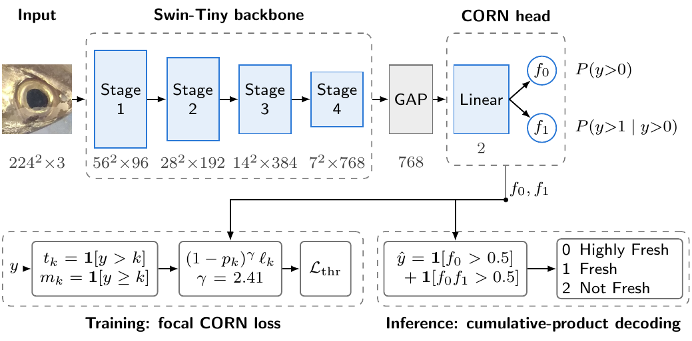

# FocalCORN-Swin: Calibration-Aware Ordinal Regression for Fish-Eye Freshness Assessment

[](LICENSE)
[](https://www.python.org/)
[](https://pytorch.org/)
[](https://github.com/xuan-tu-ai/focalcorn-swin-ffe/releases/tag/v1.0)

**Xuan Tu Nguyen, Huu Du Nguyen**
Faculty of Mathematics and Informatics, Hanoi University of Science and Technology, Hanoi, Vietnam

<p align="center">
  <a href="#overview">Overview</a> •
  <a href="#results">Results</a> •
  <a href="#installation">Installation</a> •
  <a href="#data">Data</a> •
  <a href="#trained-models">Trained models</a> •
  <a href="#reproducing-the-results">Reproduction</a> •
  <a href="#citation">Citation</a>
</p>

This is the official repository of the paper *"Calibration-aware ordinal regression
for fish-eye freshness assessment"*. It contains the code, the exact data partitions,
the hyperparameter search records, and the trained models behind every number in the
paper.

## Overview

<p align="center">
  
</p>

Freshness grades of fish (Highly Fresh, Fresh, Not Fresh) are ordered, yet existing
image-based methods on the public **Freshness of the Fish Eyes (FFE)** benchmark treat
them as unordered classes and pay little attention to whether their confidence can be
trusted. **FocalCORN-Swin** combines:

- a **Swin-Tiny** backbone (ImageNet-1k pretrained) with global average pooling;
- a **conditional ordinal regression (CORN)** head: `K-1 = 2` conditional logits whose
  cumulative-product decoding always yields rank-consistent grades;
- a **focal-weighted, threshold-averaged CORN loss** (γ = 2.41, selected by search),
  which gives well-calibrated probabilities with no post-hoc calibration stage.

The evaluation separates model selection from testing: nine head/loss/pooling
configurations are compared on development folds, each with its own Optuna search;
the selected model is then trained with ten seeds and evaluated once on a locked test
set, alongside a matched re-run of the previously best-performing pipeline. A
capture-session-disjoint split measures performance on unseen acquisition conditions.

## Results

**Image-level test set** (878 images), mean ± SD over ten training seeds:

| Method | Accuracy (%) | Macro-F1 (%) | QWK | ECE ↓ |
|---|---|---|---|---|
| **FocalCORN-Swin (proposed)** | **90.01 ± 0.64** | **89.65 ± 0.68** | **0.9083 ± 0.0091** | **0.0231 ± 0.0050** |
| CE + GAP+GMP (same backbone) | 89.75 ± 0.95 | 89.29 ± 1.02 | 0.8979 ± 0.0112 | 0.0726 ± 0.0068 |
| CE + GAP (same backbone) | 89.73 ± 0.58 | 89.28 ± 0.62 | 0.8948 ± 0.0101 | 0.0769 ± 0.0055 |
| Hoang et al. (2026), RF, matched re-run | 84.43 ± 0.91 | 83.77 ± 0.93 | 0.8326 ± 0.0178 | 0.0266 ± 0.0061 |
| Hoang et al. (2026), ET, matched re-run | 84.27 ± 1.09 | 83.56 ± 1.14 | 0.8319 ± 0.0162 | 0.1046 ± 0.0532 |

**Session-disjoint test set** (24 unseen capture sessions, 1,402 images), mean ± SD over
five seeds:

| Method | Accuracy (%) | QWK | ECE ↓ |
|---|---|---|---|
| FocalCORN-Swin (proposed) | 67.97 ± 0.48 | 0.6653 ± 0.0082 | 0.1434 ± 0.0086 |
| CE + GAP | 69.02 ± 0.93 | 0.6650 ± 0.0088 | 0.2612 ± 0.0078 |
| Hoang et al. (2026), RF, matched re-run | 64.56 ± 0.85 | 0.6352 ± 0.0125 | 0.1296 ± 0.0106 |
| Hoang et al. (2026), ET, matched re-run | 64.54 ± 0.96 | 0.6337 ± 0.0145 | 0.0801 ± 0.0287 |

Every system loses roughly 20 accuracy points (19.7 to 22.0) on unseen sessions: the image-level split
lets images of one capture session fall on both sides, so it is the more favourable
setting. Both partitions are published in [`split/`](split/). Statistical tests (paired
bootstrap over sessions and seeds, Holm-corrected), the ablation, and the calibration
analyses are in the paper.

## Repository structure

```
focalcorn-swin-ffe/
├── src/
│   ├── core.py                  # model, losses, data split, prediction rule
│   ├── train.py                 # fold training and final full-development training
│   ├── hpo.py                   # per-configuration Optuna search
│   ├── phases.py                # campaign driver (search / refit / train / evaluate)
│   ├── metrics.py               # metrics computed from saved predictions
│   ├── report.py                # LaTeX tables and figures
│   ├── baseline_hoang.py        # matched re-run of the prior-best pipeline
│   ├── session_split_run.py     # session-disjoint retraining and evaluation
│   ├── volume_control.py        # training-set-size control for the session result
│   ├── alt_branch_run.py        # the configuration the rule picks without its parsimony step
│   ├── session_bootstrap.py     # paired bootstrap over sessions and seeds, Holm-corrected
│   ├── calibration_analysis.py  # decoding convention, temperature scaling, triage, binning
│   ├── check_leakage.py         # near-duplicate analysis across the split boundary
│   ├── occlusion_test.py        # accuracy with the eye or its surroundings masked
│   ├── session_selection.py     # model selection under session-grouped validation
│   ├── export_split.py          # writes the split out as index files
│   ├── make_eigencam.py         # EigenCAM saliency figure
│   └── make_dataset_grid.py     # dataset sample grid
├── split/                       # exact partitions used in the paper (both splits, five folds)
├── configs/                     # hyperparameter search records (selected values + every trial)
├── figures/                     # stand-alone figure sources (focal weight, prior works, TikZ diagram)
├── tests/                       # pipeline invariants, pruning check, reporting dry run
├── results/                     # LaTeX tables written by src/report.py
├── docs/                        # README assets
├── REPRODUCE.md                 # step-by-step reproduction guide
└── requirements.txt
```

## Installation

Developed and tested with Python 3.12, PyTorch 2.12 (CUDA 13.0), and `timm` 1.0.27 on a
single NVIDIA GeForce RTX 4060 Ti (16 GB).

```bash
git clone https://github.com/xuan-tu-ai/focalcorn-swin-ffe.git
cd focalcorn-swin-ffe
python -m venv .venv
source .venv/bin/activate        # Windows: .venv\Scripts\activate
pip install -r requirements.txt
```

Install a PyTorch build matching your CUDA version first if needed — see
<https://pytorch.org>.

## Data

The FFE dataset (Prasetyo et al., 2022) is not redistributed here. Download it from
Mendeley Data ([doi:10.17632/xzyx7pbr3w.1](https://doi.org/10.17632/xzyx7pbr3w.1)) and
place the images under `./data/`, one folder per (species, freshness) class named
`"<Species> - <Freshness>"`:

```
data/
├── Chanos Chanos - Highly Fresh/
├── Chanos Chanos - Fresh/
├── Chanos Chanos - Not Fresh/
└── ...
```

There are **24 folders** (8 species × 3 grades) and **4,390 images**. The partitions used
in the paper are listed in [`split/`](split/) (see [`split/README.md`](split/README.md)),
so results do not depend on re-deriving the split.

## Trained models

The ten final models (the proposed configuration, one per training seed, each trained
on the full development set) are attached to the
[v1.0 release](https://github.com/xuan-tu-ai/focalcorn-swin-ffe/releases/tag/v1.0), with
a `SHA256SUMS` file. Per-seed test accuracy and kappa are listed on the release page;
seed 7 is the representative seed used for the single-seed figures of the paper.

| Files | Seeds | Size | Test accuracy (mean ± SD) |
|---|---|---|---|
| `focalcorn_swin_seed<N>.pth` | 42, 123, 999, 7, 2024, 0, 1, 2, 3, 4 | 110 MB each | 90.01 ± 0.64% |

Each file is a PyTorch state dict:

```python
import torch
from src import core

model = core.build_model({"dual_pool": False, "head": "corn"}, {"drop_path": 0.0},
                         pretrained=False)
model.load_state_dict(torch.load("focalcorn_swin_seed7.pth", map_location=core.DEVICE))
model.eval()
labels, probs, conf = core.predict(model(images.to(core.DEVICE)).cpu(), ordinal=True)
```

`images` is a batch normalised as in `core.build_transforms` (evaluation branch); labels
are 0 = Highly Fresh, 1 = Fresh, 2 = Not Fresh.

## Reproducing the results

Run the checks first:

```bash
python tests/test_pipeline.py     # invariants; exits non-zero on failure
python tests/test_pruning.py      # confirms the pruner is active
python tests/test_reporting.py    # builds every table and figure on synthetic data
```

The main pipeline then runs in four stages:

```bash
python src/phases.py search --n-trials 12 --folds 3      # per-configuration search
python src/phases.py refit                               # refit, out-of-fold predictions
python src/phases.py train --config focalcorn_gap_ours   # final models
python src/phases.py evaluate                            # single evaluation on the test set
```

[REPRODUCE.md](REPRODUCE.md) gives every command, including the comparisons, the
session-disjoint experiments, the statistics, and the tables and figures. The published
search records in [`configs/`](configs/) can replace the search stage.

## Citation

If you use this code or the trained models, please cite:

> Xuan Tu Nguyen and Huu Du Nguyen. *Calibration-aware ordinal regression for fish-eye
> freshness assessment.*

The full reference and BibTeX entry will be added after publication.

Please also cite the FFE dataset: Prasetyo et al. (2022), Mendeley Data,
[doi:10.17632/xzyx7pbr3w.1](https://doi.org/10.17632/xzyx7pbr3w.1).

## Acknowledgements

This work builds on [timm](https://github.com/huggingface/pytorch-image-models) for the
Swin Transformer backbone, [Optuna](https://optuna.org/) for the hyperparameter search,
and [coral-pytorch](https://github.com/Raschka-research-group/coral-pytorch), against
whose CORN loss our implementation is tested.

## License

Released under the MIT License — see [LICENSE](LICENSE).
